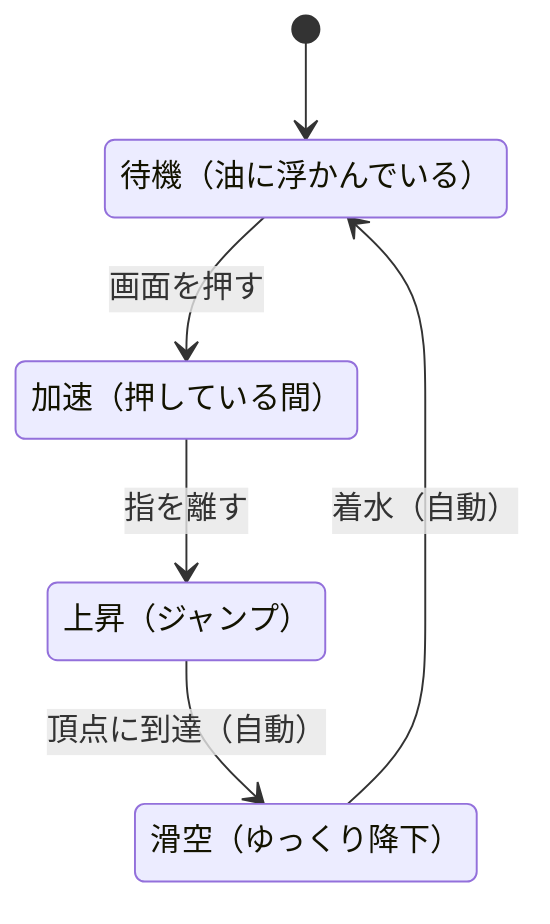
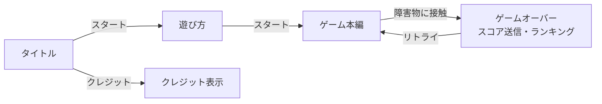

# 揚げ揚げサーフィン — ゲーム設計書

台所を舞台にした、1ボタン操作のスマホ向け横スクロールアクションゲームです。
エビフライをサーフボードにして油の上を滑り、ほかの揚げ物を飛び越えながら、どこまで遠くへ進めるかを競います。

- **ブラウザでプレイ**：[unityroom](https://unityroom.com/games/fly_to_fry_4p5k)
- **出展**：大学文化祭、コミックマーケット（冬）

## 目次

1. [概要](#1-概要)
2. [コンセプト](#2-コンセプト)
3. [ゲームルール](#3-ゲームルール)
4. [操作仕様](#4-操作仕様)
5. [画面構成と遷移](#5-画面構成と遷移)
6. [システム設計](#6-システム設計)
7. [パラメータ一覧](#7-パラメータ一覧)
8. [設計判断の記録](#8-設計判断の記録)
9. [ディレクトリ構成](#9-ディレクトリ構成)
10. [開発環境](#10-開発環境)
11. [開発体制](#11-開発体制)

---

## 1. 概要

| 項目 | 内容 |
| --- | --- |
| ジャンル | 1ボタン横スクロールアクション（エンドレス） |
| プラットフォーム | スマートフォン、PC・ブラウザ（unityroom） |
| 操作 | 画面長押しで加速、指を離すとジャンプ（PCはスペースキーでも可） |
| 目的 | 障害物に当たらずに、できるだけ遠くまで進む |
| エンジン／言語 | Unity 6000.0.59f2 ／ C# |
| 制作期間 | 6か月（文化祭まで4か月＋展示後の改修2か月） |

## 2. コンセプト

出発点は言葉遊びです。

- 「フライ」には、食べ物の **フライ（Fry：揚げ物）** と、空を飛ぶ **フライ（Fly）** の2つの意味があります
- タイトルの「揚げ揚げ」は、この **Fry を2回** 重ねたものです

```
Fry × 2 × Fly → 揚げ物に乗って空を滑空する
```

ここから、**「揚げ物に乗って空を滑空する（Fly and Fry!）」** をコアアイデアにしました。
言葉遊びで終わらせず、何度も繰り返し遊びたくなるカジュアルゲームとなることを目指し、難易度の設計や操作方法、操作感にこだわりました。
タイトルロゴ、カツの形のスタートボタン、キッチンタイマー風のスコア表示（メーカー名「TATSUTA」＝TANITA×竜田揚げ）まで、すべてを揚げ物のモチーフで統一しています。

## 3. ゲームルール

| ルール | 仕様 |
| --- | --- |
| スコア | 進んだ距離 × 0.1 ＋ 障害物を1つ越えるごとに 2 |
| ゲームオーバー | 障害物（かき揚げ・アジフライ）に接触したとき |
| ランキング | ゲームオーバー時にスコアをオンラインランキングへ送信し、順位を表示 |
| 難易度 | スコアが伸びるほど、一度に並ぶ障害物の数の上限が増える（[6.5](#65-ステージ生成)） |

## 4. 操作仕様

### 4.1 入力

| 入力 | 動作 |
| --- | --- |
| 画面を押す（スペースキーを押す） | 加速する |
| 画面から指を離す（スペースキーを離す） | その場でジャンプする |

- 画面のどこを押しても反応します。持ち方や利き手を選びません。
- 加速とジャンプは、**油に着水しているときだけ** 受け付けます。

### 4.2 操作のサイクル



プレイヤーの操作は「画面を押す」と「指を離す」の2つだけで、残りの遷移は自動で起こります。指の上げ下ろし1回で、このサイクルが1周します。このサイクルを崩さないことを、操作設計の最優先事項としています（[8.2](#82-滑空の中断機能を見送る)）。

### 4.3 駆け引きの構造

ジャンプの高さと滞空時間は常に一定です。そのため、**横方向の飛距離は、踏み切ったときの速度で決まります**。

- **遅すぎると**：飛距離が足りず、ほかの揚げ物を飛び越えられません。連続して並んだ揚げ物は、まとめて越えられなくなります。
- **速すぎると**：遠くまで飛べる一方で、反応が遅れたときに、障害物に激突する危険があります。

「どこまで加速し、どこで離すか」を毎回判断することが、本作の遊びの核です。

## 5. 画面構成と遷移

| シーン | 役割 |
| --- | --- |
| `TitleScene` | タイトル。スタート、クレジット表示、終了 |
| `HowToPlayScene` | 遊び方の説明。表示中にゲームシーンを非同期で先読みし、スタートで即座に切り替える |
| `SampleScene` | ゲーム本編。ゲームオーバー時にスコア送信・ランキング表示・リトライ |



## 6. システム設計

### 6.1 構成

| 分類 | クラス | 役割 |
| --- | --- | --- |
| プレイヤー | `PlayerMover` | 入力を受け、加速・減速・ジャンプを制御 |
| | `JumpAnimator` | ジャンプと滑空の軌道を制御（物理演算を使わない） |
| | `PlayerSearcher` | シーン内のアクティブなプレイヤーを探し、他のクラスに渡す |
| 油 | `OilDamping` | 油の中で速度に比例した抵抗をかける |
| | `IsLandingManeger` | 着水しているかを判定する |
| ステージ | `PlaceObstacle` | 障害物の生成 |
| | `OilPlacer` / `PlaceByMovement` | 油の足場の生成と、後方のオブジェクトの破棄 |
| | `PlayerFollower` | 台所の背景を、プレイヤーの移動量に一定の割合で追従させる |
| スコア | `ScoreCalculator` | 距離からスコアを計算し、表示する |
| | `AddScoreWhenPass` | 障害物を越えたときにスコアを加算する |
| | `LeaderboardManeger` / `LeaderboardShower` | オンラインランキングへの送信と表示 |
| 進行 | `TouchedPlayerTrigger` | 障害物とプレイヤーの接触を検知する |
| | `GameOverManeger` | ゲームオーバー時に移動・生成・スコア計算を止める |
| | `SceneLoader` | シーンの切り替え、先読み、リトライ |
| | `WaitForRelease` | 押されている入力が離されるまで待ってから、次の処理を行う |
| その他 | `CameraMove` | プレイヤーの横位置にカメラを追従させる |
| | `LoopMusicPlayer` | イントロ＋ループ構成のBGMを、曲をランダムに選んで再生する |
| | `FrameRateSetting` | スマートフォンでのフレームレートを設定する |

調整用の値は ScriptableObject（`Assets/ScriptableObjects/`）にまとめ、コードを変えずに調整・差し替えできるようにしています。

### 6.2 プレイヤーの移動（`PlayerMover`）

物理演算の更新（`FixedUpdate`）ごとに、次の処理を行います。

1. 着水していなければ、何もしません。
2. 常に弱い力をかけ、ゆっくりした基本速度で前に進ませます。
3. 押していないときは、基本速度を超えていて、ジャンプ中でなければ、ブレーキの力をかけて減速させます。
4. 押しているときは、最高速度に達するまで、前向きの力をかけます。

最高速度は、文化祭でのフィードバック（[8.4](#84-速度に上限を設ける)）を受けて設けたものです。

### 6.3 ジャンプと滑空（`JumpAnimator`）

指を離した瞬間に、ジャンプを開始します。ジャンプ中は重力を0にし、上下方向の速度をスクリプトで直接与えます。

**① 踏み切り**：現在位置 $y_0$ から「油面 $y_s$ ＋目標の高さ $h$」までの距離 $D$ を求めます。

$$D = y_s - y_0 + h$$

踏み切る位置が毎回違っても、その差はここで打ち消されるため、**頂点の高さはほぼ同じ**になります。

**② 上昇**：頂点までの時間を $T$ とし、時間 $t$ でちょうど $D$ だけ上がる放物線を設計します。

$$y(t) = a(t - T)^2 + D, \quad a = -\frac{D}{T^2}$$

$$y(0) = 0, \quad y(T) = D, \quad v(T) = 0$$

この微分を、毎フレームの速度として与えます。頂点（$t = T$）で速度が自然に0になります。

$$v(t) = \frac{\mathrm{d}y}{\mathrm{d}t} = 2a(t - T)$$

重力を0にしても浮力（`BuoyancyEffector2D`）は働き続けますが、速度を毎フレーム上書きするため、踏み切る前の上下の速度や浮力の影響を受けません。

実装は `Assets/Scripts/Games/Player/PlayerMover.cs` の190〜192行目（距離の計算と重力の切り替え）と、204〜215行目（上昇）です。

**③ 滑空**：頂点から一定時間、一定のゆっくりした速度で降下させます。

**④ 着水**：重力を元に戻し、油に落ちます。

位置を直接書き換えず、Rigidbody の速度として与えているため、障害物との当たり判定は物理エンジンのまま使えます。

### 6.4 油と着水判定

- **浮力**：油のプレハブに Unity 標準の `BuoyancyEffector2D` を付けています。
- **抵抗**：`OilDamping` が、油の中にある物体に速度に比例した抵抗をかけます。上下方向の抵抗を横方向より強くし、浮き沈みを早く収めます。
- **着水判定**：`IsLandingManeger` が、触れている油の数を数えます。油の足場は複数のオブジェクトをつないで作るため、つなぎ目で判定が途切れないよう、ブール値ではなく個数で管理しています。

### 6.5 ステージ生成

**障害物（`PlaceObstacle`）**：次の流れをくり返します。

1. 前の障害物がすべて後方で破棄され、**かつプレイヤーが着水している**ときまで待ちます（空中にいる間は、新しい障害物を出しません）。
2. ランダムな待ち時間を置きます。最初の1回は3秒以上にします。
3. 一度に並べる数を決めます。上限はスコア30ごとに1つ増えます。最初の1回は必ず1個です。
4. プレイヤーの前方に、ランダムな間隔で同じ種類の障害物を並べます。
5. 並べた障害物の先まで、油の足場を先回りして生成させます。

**油の足場（`OilPlacer`）**：プレイヤーの移動に合わせて一定間隔で生成し、後方に離れたものから破棄します。

### 6.6 スコアとゲームオーバー

- `ScoreCalculator` が、プレイヤーの横方向の移動量からスコアを加算します。
- 障害物ごとの `AddScoreWhenPass` が、プレイヤーが障害物を越えた時点で1回だけ加算します。
- 障害物とプレイヤーが接触すると、`TouchedPlayerTrigger` が両方をその場で止め、`GameOverManeger` が移動・障害物生成・スコア計算を停止します。

### 6.7 オンラインランキング

Unity Gaming Services の Authentication（匿名サインイン）と Leaderboards を使っています。ゲーム本編の開始時に匿名でサインインし、ゲームオーバー時にスコアを送信してランキングを表示します。

## 7. パラメータ一覧

ゲーム本編で使用している値です。

### プレイヤー（`None-head Fried Shrimp Data`）

| 分類 | 項目 | 値 | 意味 |
| --- | --- | --- | --- |
| 加速 | force | 5 | 押している間にかける力 |
| | maxSpeed | 25.5 | 最高速度 |
| | breakForce | 6 | 押していないときのブレーキの力 |
| 基本移動 | force | 1 | 常にかける弱い力 |
| | maxSpeed | 0.1 | 基本速度 |
| ジャンプ | timeToVertex | 0.25 秒 | 頂点までの時間 $T$ |
| | height | 2.8 | 油面からの頂点の高さ $h$ |
| | timeToSus | 0.4 秒 | 滑空時間 |
| | grideDownSpeed | 0.1 | 滑空中の降下速度 |

### 障害物の生成（`PlaceObstacle`）

| 項目 | 値 | 意味 |
| --- | --- | --- |
| coolTime_range | 0.5〜3 秒 | 生成前の待ち時間 |
| intervalRange | 2.2〜4 | 障害物どうしの間隔 |
| incrementStepByScore | 30 | 並ぶ数の上限が1つ増えるスコアの幅 |
| intervalFromPlayer | 18 | プレイヤーから最初の障害物までの距離 |

### 油・スコア・物理

| 項目 | 値 |
| --- | --- |
| 浮力（`BuoyancyEffector2D`）の density | 4 |
| 抵抗（`OilDamping`）の dampingX / dampingY | 0.1 / 8 |
| スコア：距離1あたり（`CmPerUnit`） | 0.1 |
| スコア：障害物1つあたり（`AddScoreWhenPass`） | 2 |
| 重力 / プレイヤーの gravityScale | -9.81 / 3 |

## 8. 設計判断の記録

### 8.1 ジャンプを物理演算から速度制御に切り替える

- **問題**：当初は、物理演算で上向きの力を加えてジャンプさせていました。プレイヤーは油の浮力で浮き沈みし続けるため、踏み切った瞬間の上下の速度が毎回違います。物理演算では、この速度にジャンプの力がそのまま足し算されるため、浮き上がる途中で踏み切ると高く飛びすぎ、着水した直後に踏み切るとほとんど跳びませんでした。これでは「狙った高さで障害物を越える」という根幹が成立しません。
- **再現実験**：当時のコードは残っていないため、ジャンプだけを物理演算に戻して各30回比較しました（Unity 6000.0.85f2）。頂点の高さ（油面基準）は、物理演算では1.0〜5.5とばらつき、踏み切った瞬間の上下の速度と強く相関しました（相関係数0.96）。踏み切ったときの深さとは、ほぼ相関がありませんでした。
- **判断**：ジャンプ中は重力を切り、上下の速度をスクリプトで直接与える方式に変更しました（[6.3](#63-ジャンプと滑空jumpanimator)）。
- **結果**：踏み切った瞬間の上下の速度や位置に関係なく、頂点の高さがほぼ一定になりました（再現実験では2.7〜3.2で、ばらつきの幅は旧方式の約10分の1）。頂点から滑空する独特の動きも、4つの値だけで調整できるようになりました。

### 8.2 滑空の中断機能を見送る

- **検討内容**：滑空中に画面を押すと、滑空を中断してすぐに着水できる機能です。
- **問題**：中断のために押した指は、着水までに次のどちらかになります。
  - **A：押したまま着水する**　着水した瞬間に加速が始まります。プレイヤーは中断のつもりで押しただけなのに、加速の操作として扱われます。
  - **B：空中で指を離す**　地上なら「ジャンプ」になる操作ですが、空中では何も起きません。同じ操作の意味が、場面によって変わってしまいます。

  どちらの場合も「押す＝加速、離す＝ジャンプ」という1対1の対応が崩れ、[4.2](#42-操作のサイクル)のサイクルが乱れます。
- **別案**：中断用に別のボタンを置く案もありましたが、「操作するボタンは1つだけ」という方針に反します。
- **判断**：中断機能の開発を中止し、操作の一貫性を優先しました。

### 8.3 空中にいる間は障害物を生成しない

障害物の生成は、プレイヤーの着水を条件にしています。空中にいる間に次の障害物が現れ、着水した直後に避けられない配置になることを防ぐためです。

### 8.4 速度に上限を設ける

文化祭の展示で「スピードが出すぎてコントロールしづらい」という声があったため、最高速度を設けました。[4.3](#43-駆け引きの構造)の駆け引きが成立する範囲に収めています。

## 9. ディレクトリ構成

```
Assets/
├── Prefabs/            油、障害物（かき揚げ・アジフライ）、プレイヤーなど
├── Scenes/             TitleScene / HowToPlayScene / SampleScene
├── ScriptableObjects/  調整用データ（プレイヤー、スコア、BGM）
├── Scripts/
│   ├── Games/
│   │   ├── Player/       移動・ジャンプ
│   │   ├── Rigid/        油の抵抗、着水判定、接触判定
│   │   ├── StageMaker/   障害物・油の生成
│   │   ├── Score/        スコア、ランキング
│   │   └── Fired/        障害物通過時のスコア加算
│   ├── SceneManege/    シーン遷移、終了
│   └── Data/           JSON保存（試作。本編では未使用）
├── Sounds/             BGM（イントロ＋ループ）
└── Texture/            イラスト素材
```

## 10. 開発環境

| 項目 | 内容 |
| --- | --- |
| エンジン | Unity 6000.0.59f2（URP、2D） |
| 言語 | C# |
| 主なパッケージ | UniTask、Input System、Unity Gaming Services（Authentication / Leaderboards） |
| バージョン管理 | Git / GitHub |
| タスク管理 | Jira |

## 11. 開発体制

大学サークルの3名で開発しました。

| 担当 | 内容 |
| --- | --- |
| 企画・プログラム・ディレクション | 1名（本リポジトリのコードはすべてこの担当が実装） |
| キャラクター・UIデザイン、音楽制作 | 2名 |
